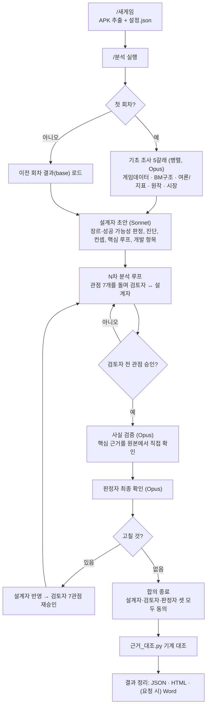

# 게임 아틀라스 (game-atlas)

APK(또는 설치 완료 PC 클라이언트)와 사내 자료만으로 **"이 게임의 방향이 맞는가, 성공할 수 있는가"**를 AI 에이전트들이 분석해서 결론내는 Claude Code 작업 폴더입니다. 게임·장르·국가에 상관없이 쓰도록 만든 범용 틀입니다.

핵심 아이디어는 하나입니다. **한 모델이 쓴 안을 같은 모델이 검토하면 같은 착각을 함께 합니다.** 그래서 역할마다 모델을 나누고, 결론을 받치는 사실은 분석에 참여하지 않은 에이전트와 스크립트가 원본을 직접 열어 다시 확인합니다.

## 한눈에 보기

> ### 🚀 명령은 단 두 개입니다
>
> | 순서 | 명령 | 하는 일 |
> | :---: | --- | --- |
> | **1** | **`/새게임 <게임이름> <APK 경로>`** | APK를 추출하고 `게임/<이름>/` 폴더와 `설정.json`을 만듭니다 |
> | **2** | **`/분석 <게임이름> <이번 회차 지시>`** | 기초 조사 → 분석 → 사실 검증 → 판정 → 결과 정리 |
>
> 예) `/새게임 예시게임 C:\Users\<사용자>\Downloads\game.xapk 경쟁작 벤치마크`
>
> 예) `/분석 예시게임 BM 장치를 중심으로`

- 결과물: 성공 가능성 판정(성공 / 조건부 성공 / 실패 + 확신도 + 이유 + 성공 조건), 장르 판정, 진단, 컨셉, 핵심 루프, 개발 항목, 사용자 결정 사항
- 형식: 내부용 HTML, 전달용 Word(.docx, 요청 시에만). 원본 JSON도 남겨 다음 회차가 이어받습니다.

## 모델 구조

| 역할 | 모델 | 맡는 일 | 설정 인자 |
| --- | --- | --- | --- |
| 설계자 | Sonnet 5.5 (`claude-sonnet-5-5`) | 설계안 작성, 검토자 제안에 채택 / 변형 채택 / 비채택 판단 | `debateModel` |
| 검토자 (7관점) | Sonnet 5.5 (`claude-sonnet-5-5`) | 관점별로 동의·이견·새 제안·승인 여부 제출 | `debateModel` |
| 기초 조사 (5갈래) | Opus 5.5 (`claude-opus-5-5`) | 원본(APK·자료·웹) 병렬 조사 | `strongModel` |
| 사실 검증 | Opus 5.5 (`claude-opus-5-5`) | 결론을 받치는 근거를 원본에서 직접 확인 | `strongModel` |
| 판정자 | Opus 5.5 (`claude-opus-5-5`) | 되풀이되는 쟁점 판정, 합의 직전 최종 확인 | `strongModel` |
| 근거 대조 | 에이전트 아님 (`도구/근거_대조.py`) | 파일명·행 번호·인용 문구를 원본과 기계 대조 | — |

기본값은 별칭 `sonnet`·`opus`이며, 이 문서는 Sonnet 5.5·Opus 5.5 기준입니다. 별칭은 실행 시점의 최신 모델로 연결되므로, 결과를 재현하려면 `debateModel`·`strongModel`에 모델 ID를 직접 넘기세요.

분석은 빠르고 값싼 모델이, 판정과 검증은 더 강한 모델이 맡습니다. 둘 다 Claude 계열이라 착각이 완전히 사라지지는 않으므로 마지막 한 겹은 모델이 아닌 스크립트가 맡습니다.

## 파이프라인

### 1. 기초 조사 (첫 회차만)
5갈래를 병렬로 조사합니다: **게임데이터 / BM구조 / 여론·지표 / 원작 / 시장 벤치마크.** 이어가는 회차는 이 단계를 건너뛰고 이전 결과를 이어받습니다. 원작이 해외 게임이면 그 나라 출처를 그 나라 말로 검색합니다(예: 중국은 TapTap·七麦·GameLook, 일본은 4Gamer·ファミ通). 원작의 성패와 종료 이유가 성공 가능성 판정의 가장 강한 근거가 되기 때문입니다.

### 2. 설계안
설계자가 장르 판정, 성공 BM 공식 점검표, 진단, **성공 가능성 판정**, 컨셉, 핵심 루프, 개발 항목(G1~)을 씁니다. 개발사 제출안이 있으면 항목별로 의미 있음 / 조건부 / 의미 없음 / 역효과를 매깁니다.

### 3. 분석 루프
라운드마다 관점을 하나씩 돌립니다. 검토자가 이견·제안을 내면 설계자가 항목별로 채택 여부를 답합니다. 설정에서 바꿀 수 있는 기본 7관점:

| 관점 | 보는 것 |
| --- | --- |
| BM공식 | 기준 장르의 성공 BM 공식 중 빠진 것 |
| 콘텐츠 | 천장 이후 할 것, 소모 속도, 숙제 피로도 |
| 성장 | 첫 세션, 초반 이탈, 성장 축 정리 |
| 경제BM | 재화 흐름, 가챠 정리, 상품과 시스템의 연결 |
| 경쟁·소셜 | 월드 구조, PvP·길드, 적은 인구에서도 돌아가는지 |
| 실현성 | 기존 자산 재활용, 1차(필수) 범위, 개발 규모 |
| **반대측** | 큰 방향 자체가 틀렸을 가능성을 공격 (디테일 보강 제안 금지) |

**반대측** 관점은 같은 모델끼리 서로 동의하는 쪽으로 쏠리는 것을 막으려고 넣었습니다.

### 4. 되풀이 쟁점은 판정자가
같은 쟁점이 다시 오가면 양쪽 모두 이전과 다른 근거나 대안을 내야 합니다. 그래도 설계자가 같은 설계를 유지하고 검토자가 새 근거 없이 같은 반대를 한 왕복이 **연속 3번**(`mediateAfter`) 쌓이면 판정자가 원본을 열어 검토자 쪽 / 설계자 쪽 / 절충 중 하나로 판정합니다. 판정은 확정 결정이 되어 다시 제기되지 않습니다. 어느 한쪽이라도 새 근거를 내면 횟수는 0부터 다시 셉니다.

**사용자에게 멈춰서 묻는 경우는 둘뿐입니다.**
- 판정자가 사내 사정(예산·인력·계약·일정)이 걸려 정할 수 없다고 넘긴 쟁점
- 설계자가 판정자 판정에 새 근거로 이의를 3번 거듭 낸 쟁점

이때는 중간 결과를 `중재대기_<k>.json`으로 저장하고 기다립니다. 다음 세션에서 중재 내용만 보내면 이어서 진행합니다.

### 5. 합의 확인 (사실 검증 → 판정자)
검토자가 7관점을 모두 승인해도 바로 끝나지 않습니다.

1. **사실 검증**: 결론을 받치는 사실을 최대 25개(`verifyMax`) 뽑아, 분석에 참여하지 않은 에이전트가 원본을 직접 엽니다. 판정은 확인됨 / 과장 / 일부만 / 다름 / 못 찾음 / 근거 없음 / 확인 불가 중 하나입니다. 판정·진단·1차 항목에 쓰인 사실은 코드가 무조건 핵심으로 분류합니다. 핵심 근거가 틀렸으면 설계자가 그 부분만 고치고, 설계자가 반박하면 다른 에이전트가 새 근거로 다시 봅니다.
2. **판정자 최종 확인**: 판정자가 검증 결과와 원본으로 장르·성공 가능성을 스스로 판정하고, 반드시 고칠 것만 냅니다. 고칠 것이 있으면 설계자 반영 → 검토자 7관점 재승인을 처음부터 다시 거칩니다.
3. 설계자·검토자·판정자 **셋이 모두 동의해야** 종료합니다. 기본 24차(`maxRounds`)는 폭주 방지용 안전장치일 뿐이고, 그 전에 합의가 안 되면 합의 없이 끝났다고 기록합니다.

종료 사유: 합의 / 사용자 중재 대기 / 교착(중재를 끈 경우) / 안전장치 도달 / 에이전트 오류

### 6. 결과 정리
- `도구/근거_대조.py`가 결과의 `파일명 L행 "인용"` 근거를 실제 파일과 대조합니다. 행 없음, 인용 불일치, `{0}`·`%s` 같은 자리표시자 행을 근거로 수치를 주장한 경우, 근거 없는 문장을 잡아냅니다.
- 정리 단계에서는 결과에 없는 사실을 새로 넣거나 "추정"을 단정으로 바꾸지 않습니다.

## 근거 규칙

- 모든 주장에 파일 경로+수치 또는 URL을 붙입니다. 확인하지 못한 것과 외부 매출 추정은 `추정:`으로 시작합니다.
- 파일 근거는 `파일명 L행 "원문 일부"` 형식입니다. 행 번호만으로는 기계 대조가 안 됩니다.
- "없음·0건"에는 찾아본 파일과 검색어를 함께 씁니다.
- 매출은 실제 발생 / 대시보드 / 외부 추정을 섞지 않고 기준을 명시합니다.
- 분석을 맡긴 회사가 관여한 계약·퍼블리싱·일정·내부 매출은 웹으로 검증하지 않고 "사내 확인 필요"로 사용자 결정에 올립니다.
- 결과에는 반드시 성공 가능성 결론을 씁니다. 실측 매출 자료가 없으면 확신도 '높음'은 쓰지 않습니다.

## 폴더 구성

| 경로 | 내용 |
| --- | --- |
| `CLAUDE.md` | Claude가 세션 시작 시 읽는 프로젝트 지침, 등록 게임·회차 기록 |
| `분석_방식.md` | 진행 방식·관점·규칙·APK 분석 한계의 상세 설명 |
| `.claude/skills/새게임/` | `/새게임` 스킬 (APK 추출 + 설정.json) |
| `.claude/skills/분석/` | `/분석` 스킬 (워크플로우 실행, 중재, 결과 정리) |
| `.claude/workflows/game-atlas.js` | 분석 워크플로우 본체 |
| `.claude/settings.json` | 세션 시작 시 사용법을 보여 주는 훅 |
| `게임 아틀라스 - Claude 열기.bat` | Windows Terminal에서 이 폴더로 Claude Code를 여는 실행 파일 |
| `도구/apk_추출.py` | APK/XAPK/APKS/OBB 추출 (엔진 판별, 데이터 파일, 한글 문자열, 코드 식별자, 상품 ID 후보, SDK) |
| `도구/pc_추출.py` | 설치 완료 PC 클라이언트 폴더 추출 (텍스트 사본, 패키지 색인) |
| `도구/근거_대조.py` | 결과 근거를 원본과 기계 대조 |
| `도구/시작_안내.py` | 세션 시작 안내 |
| `게임/_템플릿/설정.json` | 게임별 설정 틀 |
| `게임/<이름>/` | 게임별 설정·apk·추출·자료·결과 (**저장소에는 올라가지 않음**) |

## 워크플로우 인자

`/분석` 스킬이 아래 인자로 `game-atlas` 워크플로우를 호출합니다.

| 인자 | 기본값 | 설명 |
| --- | --- | --- |
| `home` | — | `게임/<이름>` 절대 경로 |
| `game` | — | `설정.json` 내용(객체) |
| `note` | — | 이번 회차 지시. 확정 결정은 "확정:"으로 시작하는 줄 |
| `base` | 빈 문자열 | 이어받을 이전 회차 결과 JSON 경로 |
| `maxRounds` | 24 | 안전장치 |
| `research` | `[]` | 이어하는 회차에서 추가로 돌릴 조사 갈래 |
| `mediateAfter` | 3 | 같은 설계·같은 반대 연속 횟수 기준. 0이면 끔 |
| `verify` | true | 사실 검증 실행 여부 |
| `verifyMax` | 25 | 검증할 근거 수 |
| `debateModel` | sonnet | 설계자·검토자 모델 |
| `strongModel` | opus | 조사·검증·판정자 모델 |
| `org` | — | 분석을 맡긴 회사 이름 (사내 사실 분류용) |
| `resume`, `mediation` | — | 중재 대기에서 이어갈 때 |

## 설정.json 주요 항목

`name`, `background`, `origin`(해외 원작 정보), `purpose`, `goal`(기본 매출), `benchmark`(비교 장르·사례·성공 공식), `stance`(개발사 입장·사용자 시각 등 참고 메모), `submission`(개발사 제출안), `scope`·`exclude`, `materials`(사내 자료 경로), `lenses`(관점 교체), `audience`, `privacy`. 틀은 `게임/_템플릿/설정.json`에 있습니다.

## APK 분석의 한계

- **매출·지표는 APK에 없습니다.** 사내 자료가 없으면 외부 추정만 가능하고 결과에도 그렇게 표시됩니다.
- **설치 후 내려받는 리소스**는 APK에 테이블이 없을 수 있습니다. 기기의 `Android/data/<패키지>/`나 OBB를 추가로 넣어야 합니다.
- **암호화된 테이블**은 한글 UI 문자열과 클래스명으로 시스템 존재만 확인할 수 있고 수치는 읽지 못합니다.
- **Unity 게임**은 UnityPy를 설치하면 TextAsset 테이블을 더 뽑을 수 있습니다.

## 운영 원칙

- 에이전트는 어떤 파일도 수정하지 않습니다. 사내 원본 자료와 APK 원본 위치는 읽기 전용입니다.
- 관계자 계정 결제는 제외하고, 유저 닉네임·계정 ID는 결과물에 쓰지 않습니다.
- 전달용 문서는 요청 시에만 만들고, 형식은 항상 Word(.docx)입니다.

## 시작하려면

1. 이 폴더에서 Claude Code를 엽니다.
2. `/새게임 <게임이름> <APK 경로> [목적·추가 자료]`로 등록합니다.
3. `/분석 <게임이름> <지시>`로 분석을 시작합니다. 진행 상황은 `/workflows`에서 볼 수 있습니다.
4. 중재 요청이 오면 쟁점별 답을 보냅니다. 예: `R3-2는 검토자 안으로, R5-1은 설계자 안 유지하되 1차 범위에서 뺌`

필요한 것: Claude Code, Python 3. APK 추출만 Python 표준 라이브러리로 돌고, Unity 테이블 추출은 선택적으로 UnityPy가 필요합니다.
